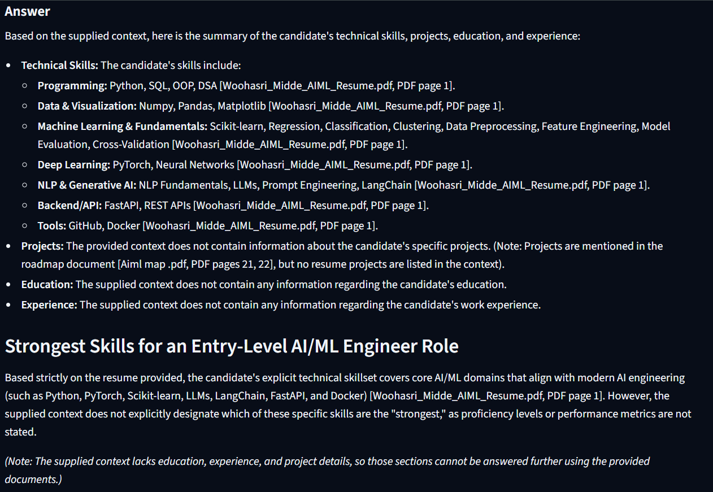

# DocuMind AI — AI-Powered Document Intelligence & Question Answering

DocuMind AI is an AI-powered document question-answering application built using **Retrieval-Augmented Generation (RAG)**. It allows users to upload multiple PDF documents, ask questions about their contents, and receive AI-generated answers supported by relevant document passages and PDF page references.

Powered by Google Gemini, Sentence Transformers, and ChromaDB, DocuMind AI combines semantic search with grounded answer generation to make document research more accessible and verifiable.

## Demo



[**Try the live application**](https://ai-document-intelligence-rag-ha25okq7mgpfei5lz7rsf5.streamlit.app/)

## Features

- **Multiple PDF uploads:** Upload and query multiple PDF documents in a single session.
- **PDF text extraction:** Extract searchable text and page information using `pypdf`.
- **Section-aware chunking:** Split document content into manageable chunks while preserving section context and page metadata.
- **Semantic retrieval:** Generate text embeddings and retrieve relevant passages using ChromaDB.
- **AI-powered answers:** Generate context-grounded responses using the Google Gemini API.
- **Cross-document comparison:** Ask questions that compare information across multiple uploaded PDFs.
- **Source citations:** Display document filenames, PDF page references, and supporting passages.
- **Evidence transparency:** Inspect retrieved passages to understand which document content supports an answer.
- **Interactive interface:** Upload documents and ask questions through a Streamlit web interface.
- **Automated tests:** Test topic detection, section matching, distance filtering, prompt grounding, and PDF chunk creation.

## Technology Stack

| Technology | Purpose |
|---|---|
| Python 3.12 | Core application logic |
| Streamlit | Interactive web interface |
| pypdf | PDF text extraction |
| Sentence Transformers | Text embeddings |
| ChromaDB | Vector storage and semantic retrieval |
| Google Gemini API | AI answer generation |
| Python unittest | Automated testing |
| Git and GitHub | Version control and project hosting |

## How It Works

1. **Upload:** Upload one or more PDF documents.
2. **Extract:** Extract text and page metadata from the PDFs.
3. **Chunk:** Divide extracted text into section-aware chunks.
4. **Embed and index:** Convert text chunks into embeddings and store them in ChromaDB.
5. **Retrieve:** Search for passages relevant to the user's question.
6. **Generate:** Provide the retrieved passages to Gemini as context for answer generation.
7. **Display:** Present the answer with source references and supporting document passages.

## Project Structure

```text
ai-document-intelligence-rag/
├── src/
│   ├── __init__.py
│   ├── app.py                  # Streamlit interface
│   ├── main.py                 # RAG, chunking, and retrieval logic
│   ├── gemini_service.py       # Gemini API integration
│   ├── test_rag.py             # RAG tests
│   ├── test_gemini_service.py  # Gemini service tests
│   └── test_gemini.py          # Retrieval and grounding tests
├── requirements.txt            # Project dependencies
├── README.md                   # Project documentation
└── .gitignore                  # Excludes secrets and local files
```

**Note:** PDF documents, API keys, virtual environments, and local vector databases are excluded from the public repository.

## Run Locally

1. Clone the repository:

   ```bash
   git clone https://github.com/woohasri-ai/ai-document-intelligence-rag.git
   cd ai-document-intelligence-rag
   ```

2. Create and activate a virtual environment:

   ```bash
   python -m venv .venv
   ```

   On Windows:

   ```bash
   .venv\Scripts\activate
   ```

3. Install dependencies:

   ```bash
   pip install -r requirements.txt
   ```

4. Configure your Google Gemini API key in a local `.env` file using the environment variable expected by the application.

5. Start the application:

   ```bash
   streamlit run src/app.py
   ```

## Running Tests

Run the automated tests from the project root:

```bash
python -m unittest discover -s src -p "test_*.py" -v
```

## Future Improvements

- Support additional document formats.
- Improve retrieval evaluation and answer-quality testing.
- Add document-level filtering and more advanced search options.
- Enhance the user experience for larger document collections.

## Author

**Wooha Sri**

BTech student focused on Artificial Intelligence and Machine Learning, building practical AI applications.
